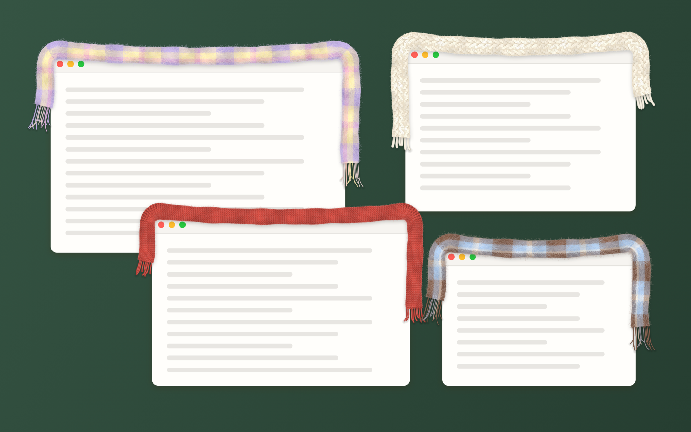
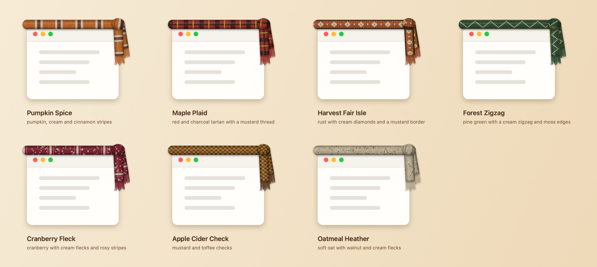
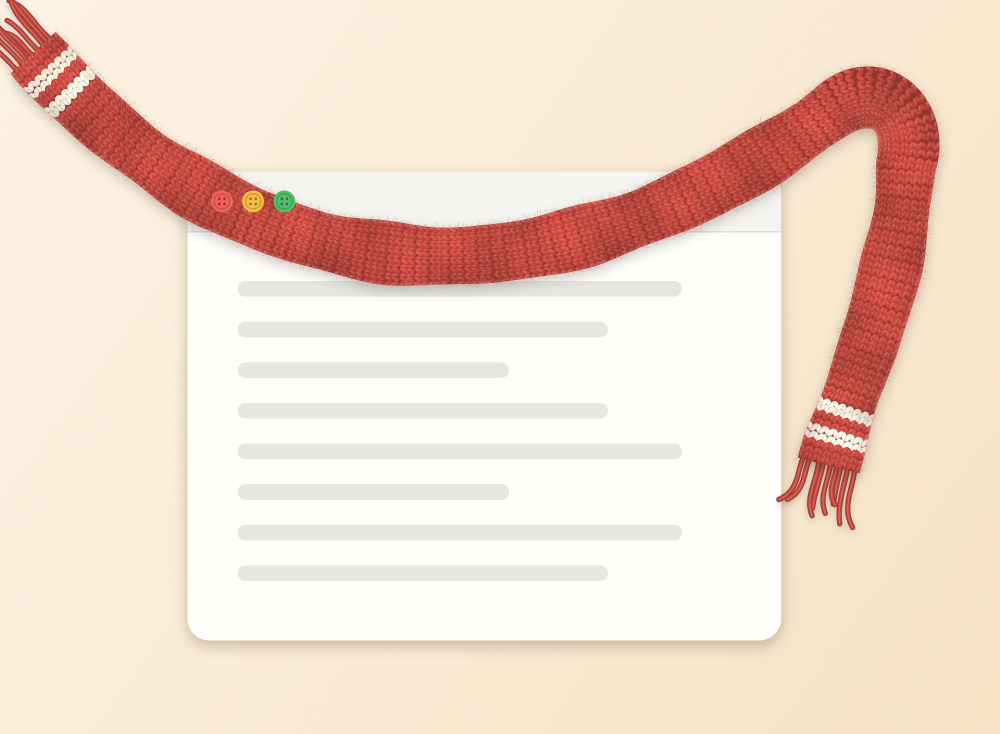

# window-scarves

A little macOS menu-bar app that gives each of your windows a cosy scarf for autumn. 🧣🍂



## The collection



Every app gets a different scarf. Choose **Shuffle** in the menu to deal them out again, or pick one scarf for every window.



## Get it

Window Scarves needs macOS 13 or later. It's built for both Apple Silicon and Intel Macs, and so far it has been tested on Apple Silicon.

### Download

1. Download **Window-Scarves.zip** from the [latest release](https://github.com/fiof25/window-scarves/releases/latest).
2. Unzip it and drag **Window Scarves.app** into your Applications folder.
3. Open it. Look for 🧣 in your menu bar.

The first time you open it, macOS will block it, because the app isn't signed with a paid Apple developer account. To allow it, open **System Settings → Privacy & Security**, scroll down, and click **Open Anyway**. You only need to do this once.

### Build it yourself

You need Apple's Command Line Tools (`xcode-select --install`). Xcode itself isn't needed.

```sh
git clone https://github.com/fiof25/window-scarves.git
cd window-scarves
./build.sh --install
```

This builds the app, copies **Window Scarves.app** into `~/Applications`, and opens it. Run `./build.sh` without `--install` to build into `build/` only, or `./build.sh --zip` to also make a zip for a release.

## Make yourself cosy

Press **⌃⌥S** (Control-Option-S) anywhere to turn the scarves off and on.

Click 🧣 in the menu bar for the rest:

- **Scarf**: Mixed, Shuffle, or one scarf for every window
- **Long End**: on the right or on the left
- **Thickness**: Slim, Cosy or Chunky
- **Windows**: every window, or only the front one
- **Apps**: untick an app to leave its windows bare
- **Keyboard Shortcut ⌃⌥S**: turn the shortcut off if you don't want it
- **Start at Login**: open Window Scarves automatically when you log in

Not every window gets one. A window that fills the whole screen goes bare, and so do small popovers, hover cards and dialogs that sit on top of another window. macOS won't say what kind of window something is without extra permission, so the app judges by size and position. That means a small window resting on a bigger one from the same app also goes bare until you move it off.

The scarf stays on the window's top edge, so it never covers the red, yellow and green buttons. If there's no room on screen beside a window, the long end moves to the other side, the short end is left off, and as a last resort the long end tucks just inside the window's right edge.

## How it works

Window Scarves uses only public macOS APIs, and it doesn't need any permissions.

- `CGWindowListCopyWindowInfo` reports where every window is and how they're stacked.
- Each scarf is a few small transparent, click-through windows, ordered directly above the window it's worn by. They cover only the scarf, so nothing invisible sits over the app's own content, and windows in front still cover the scarf, just like real fabric.
- The app checks the windows 10 times a second when nothing is happening, and 120 times a second while anything is moving, so scarves keep up with drags and resizes without wasting power.
- Scarves are made into images in the background and remade as a window is resized. The knitted ones are made in several strips at once on separate processor cores. The mohair ones are mostly see-through drawing, which macOS can't safely do on several cores at once, so they're made in one go. Scarves fade in rather than popping, and the app idles at about 1 to 2% CPU.

Render the preview images without touching your real windows:

```sh
"build/Window Scarves.app/Contents/MacOS/WindowScarves" --render docs
```

To check the scarf-making code without touching any windows (thousands of checks, including that scarves knitted in parallel pieces match ones knitted whole):

```sh
"build/Window Scarves.app/Contents/MacOS/WindowScarves" --self-test
```

To see exactly what the app is drawing on your real windows, start it with `SCARVES_SNAPSHOT` set to a folder. A few seconds later it saves a picture of each scarf there:

```sh
open --env SCARVES_SNAPSHOT=/tmp/scarves "build/Window Scarves.app"
```

## Taking it off

Choose **Quit Window Scarves** from the 🧣 menu and drag the app to the Trash. To clear its saved settings as well:

```sh
defaults delete com.fiof25.windowscarves
```

## Ideas for later

- Sewing buttons over the red, yellow and green window buttons
- Falling leaves drifting past the active window
- Choosing a scarf for each app by hand
- More textures: bouclé, a blanket scarf
- Choosing your own keyboard shortcut
- A winter collection

## Credits

Inspired by Sara Gordić's lovely [Window Sweaters](https://github.com/saragordic/window-sweaters), which gives your windows knitted sweaters. Window Scarves is a separate project written from scratch in Swift, and it shares no code with Window Sweaters.

Released under the MIT License. See [LICENSE](LICENSE).
